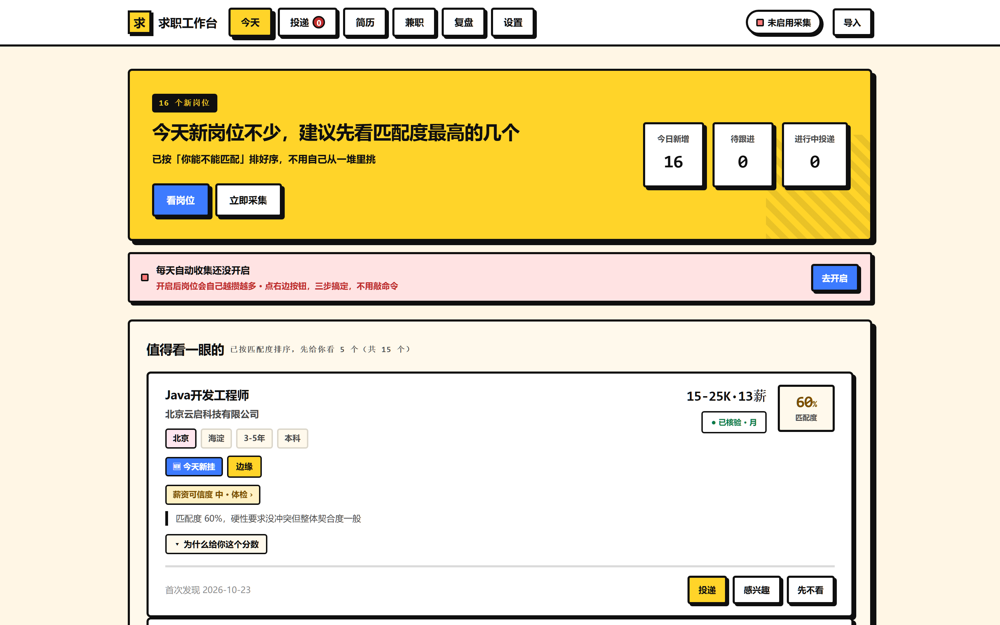
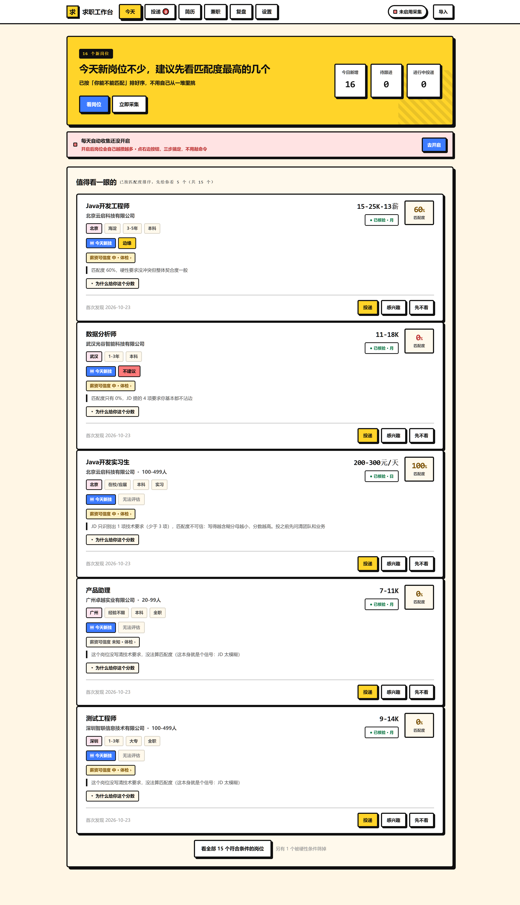
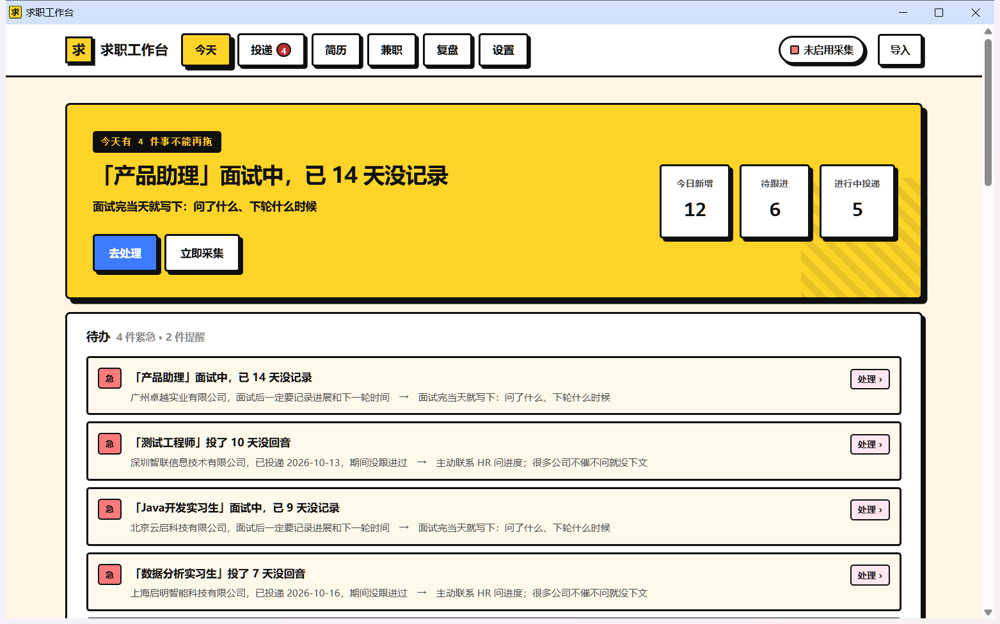
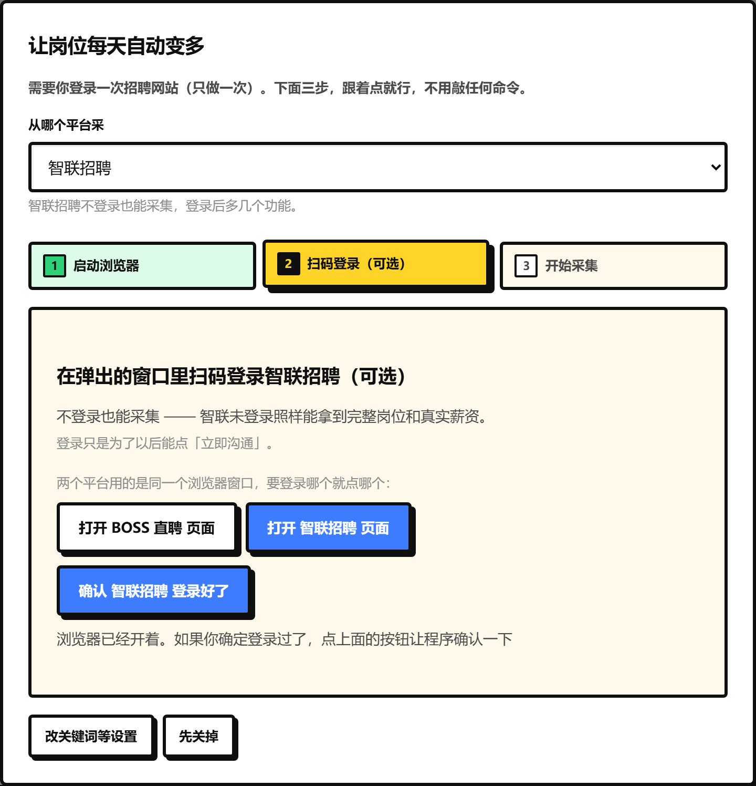

# 求职工作台

> 每天自动帮你把该投的岗位挑出来。

面向大学生 / 应届生 / 刚找工作的人。**数据全部留在本地**，不上传任何服务器。



上图是首页：左边是导航，右边直接告诉你**今天该做什么** ——
新岗位有多少、哪几个值得先看、每个岗位**匹配度多少、结论是什么、为什么**。

---

## 它解决什么问题

求职者不缺岗位信息，缺的是**「我该投哪个、为什么、我还差什么」**。

求职工作台的求职闭环：

```
① 发现   每天自动采集，岗位自己变多
② 评估   「你能不能匹配」+ 差在哪 + 证据原文
③ 投递   投了哪些、什么时候、用的哪版简历
④ 跟进   几天没回音该催了，面试完要记下一步
⑤ 复盘   投出去的哪些真的有回音，匹配度有没有用
```

首页不做岗位信息流，第一屏只回答一个问题：**今天该做什么。**

<details>
<summary>（展开看完整首页）</summary>



注意几个细节：

- **按匹配度排序**，但**「无法评估」的岗位一律垫底** —— JD 写得越含糊，匹配度越不可信，
  这种时候工具会明说「投之前先问清团队和业务」，而不是给你一个漂亮的假分数
- 每张卡都标了**薪资可信度**（已核验 / 待确认 / 未解析）和**体检结论**，
  两件事独立显示 —— 匹配度 60% 的岗位可能根本不在招人
- 实习岗单独标**日薪**，不折算成月薪参与评分
- 底部写着「另有 1 个被硬性条件筛掉」—— **筛掉的理由也给你看**

</details>

---

## 快速开始

### 方式一：下载压缩包，双击就行（推荐给不熟悉 Git 的人）

到 [Releases](https://github.com/maning636/JobBench/releases) 下载最新压缩包，
解压之后**双击 `启动桌面版.bat`**（想要网页版就双击 `启动.bat`）。

`启动桌面版.bat` 会弹出一个**独立的应用窗口** —— 没有地址栏、没有标签栏，
就像一个正经软件：

- 标题栏写「求职工作台」，图标是我们自己的
- **关掉窗口就等于退出程序**，后台服务跟着一起收摊

它会自己检查环境、装好缺的东西、启动服务并打开窗口。
第一次运行需要联网一两分钟，之后秒开。

想关掉它：关掉那个应用窗口就行。

> 卡在哪一步了？把弹出的黑窗口里的字截图发给帮你的人就行。

### 方式二：克隆仓库自己跑

```bash
git clone https://github.com/maning636/JobBench.git
cd JobBench
pip install -r requirements.txt
python -m jobforge.cli web        # → http://127.0.0.1:8080
```

想要桌面窗口就换成：

```bash
python -m jobforge.desktop         # → 独立应用窗口
```

桌面版长这样（就是一个独立窗口，没有地址栏、没有标签栏）：



### 想先看看效果（不用登录任何网站）

```bash
pip install -r requirements.txt      # Flask + beautifulsoup4 + websockets

python -m jobforge.cli seed          # 导入 16 条演示数据，先看看长什么样
python -m jobforge.cli web           # → http://127.0.0.1:8080
python -m jobforge.cli test          # 全部测试
```

### 让岗位数量自己变多

平台**不提供「按发布时间回溯」的能力**——搜索结果只给当前在招的。
所以历史只能靠每天积累。抓取需要你自己的 Chrome 登录态。

**界面上点「立即采集」**，先选平台（BOSS 直聘 / 智联招聘），跟着三步走：
启动浏览器 → 扫码登录一次 → 开始采集。
全程不用敲命令，登录过一次之后长期有效。

> 两个平台的登录要求不一样：**BOSS 必须登录才采得到东西**；
> **智联不登录也能采**（实测未登录照样返回完整岗位和真实薪资），
> 登录只是为了以后能点「立即沟通」。

想让电脑每天定时自己采：到「设置」页点「开启每日自动采集」，
选个时间点就行。

<details>
<summary>（开发者）对应的命令行写法</summary>

```bash
# 用调试端口启动一个独立的 Chrome（只需一次，登录态会保留）
chrome.exe --remote-debugging-port=9222 --user-data-dir="%TEMP%\chrome-jobforge"

python -m jobforge.cli collect --check                      # 连通性自检
python -m jobforge.cli collect --keyword Java --pages 3     # 采集一次（BOSS）
python -m jobforge.cli collect --source zhaopin \
       --keyword Java --city 北京 --pages 3                # 采集一次（智联）
python -m jobforge.cli install-task --time 09:30            # 安装每日计划任务
```

</details>

> 电脑关机时计划任务不会执行。那几天回来点一次「立即采集」即可，
> 照样能积累 —— 但别指望它自动补跑。

### 导入岗位（不装浏览器也能用）

界面上点「导入」，把招聘平台页面复制的岗位信息粘进来，
多个岗位用**空行**隔开。也支持中文表头的 CSV。

解析不出来的字段会**留空并标注**，不会瞎猜。

---

## 支持哪些平台

| 平台 | 状态 | 要登录吗 | 备注 |
|---|---|---|---|
| BOSS 直聘 | ✅ 已实现 | 必须 | 扫码登录一次即可长期复用 |
| 智联招聘 | ✅ 已实现 | **不登录也能采** | 登录后多几个功能（可点「立即沟通」） |
| 前程无忧 / 拉勾等 | ❌ 未实现 | — | 见「还没做的」 |

两个平台的采集方式**不是同一套**，但对外的用法一样（选平台 → 扫码 → 采集）：

- **BOSS** —— 浏览器登录后直接读列表页 DOM。
- **智联** —— 智联已经改版，老接口全部失效（实测：老接口只返回
  `results:[]` + `numFound:999999` 的反爬占位值）。现在走的是
  **在页面里 POST 智联自己的列表接口**（`/c/i/search/positions`），
  参数是从智联的 JS 里挖出来的真实参数名（`S_SOU_FULL_INDEX` /
  `S_SOU_WORK_CITY`）。
  智联页面上显示的薪资是打码的（`**-**元`），真值只存在于接口返回里。

> 智联的城市必须用**数字码**（北京 = 530，上海 = 538 …，共 462 个城市）。
> 传中文名智联**不报错**，会静默返回别的城市的数据 ——
> 所以本工具查不到城市时**直接报错**，绝不猜一个。

界面上选平台就行，第 2 步的文案和判断会跟着平台变
（智联那一步写的是「扫码登录（可选）」，因为它不登录也能采）。

两个平台**用的是同一个浏览器窗口**，所以第 2 步给了两个按钮：
要登录哪个就点哪个 —— 你可以两个都登录，随时切。



---

## 命令行

```bash
jobforge web                                  # 启动界面
jobforge collect --check                      # 浏览器连通性自检
jobforge collect --keyword Java --pages 3     # 采集一次（BOSS 直聘）
jobforge collect --source zhaopin --keyword Java --city 北京   # 采集一次（智联招聘）
jobforge collect --history 10                 # 采集历史
jobforge collect --fast                       # 跳过页间等待（不推荐）

jobforge profile 我的简历.txt --name 张明       # 建立档案
jobforge analyze --top 5                      # 批量分析（默认不调 LLM）
jobforge analyze --top 5 --llm                # 加语义分析
jobforge analyze --match Java --all -v        # 按岗位名匹配，看详情

jobforge list --top 30                        # 看岗位库
jobforge import 岗位.csv                       # 导入文件
jobforge daily --dry-run                      # 跑一次每日任务（不发消息）
jobforge install-task --time 09:30            # 安装 Windows 计划任务
jobforge test                                 # 全部测试
```

---

## 几条不妥协的底线

### 1. 不做假

简历里没写的技能一律算**缺失**，绝不用「推测你会」来加分。
虚假匹配比不匹配更糟——会让人投出一个必败的简历。

### 2. 薪资宁可空着，不可错着

招聘平台会用自定义字体把薪资数字做 PUA 编码。
我们**不做猜测式解码**，而是四态标注：

| 状态 | 含义 |
|---|---|
| `已核验` | 文本结构可确定解析 |
| `待确认` | 有猜测成分，界面会标注 |
| `未解析` | 解析不出，不参与薪资维度评分 |
| `不标注` | 岗位本身不标薪资（面议） |

实习日薪（`200-300元/天`）与月薪语义完全不同，**已隔离，绝不折算成月薪参与评分**。

### 3. 每条结论都能核对

匹配度、外包判定、薪资——全部带**原文片段**。
外包识别给的是判据原句，不是「疑似外包」四个字了事。

### 4. LLM 不能推翻硬结论

```
规则引擎  负责：事实、硬门槛、可核对的数字     —— 永远优先
LLM      负责：语义补充、措辞建议、可读的解释   —— 只做加法
```

学历不符、经验不符这些是程序算出来的事实，模型说「其实可以」也不能改。

模型有**四道防幻觉闸门**：要求逐字摘录 → 校验两侧证据长度 →
检查模型是否自认「无证据」→ **把摘录拿去原文比对**（改一个字就穿帮）。

置信度不足的结论不丢弃，而是**降级呈现**并注明「这是推测不是结论」。

### 5. 数据不达标就不推送

完整率、必填缺失率、薪资可解析率任一不达标，**只发告警，不推岗位**。
抓不到数据 ≠ 今天没岗位 —— 这两件事必须区分开。

### 6. 规则优先，LLM 可选

不填模型配置，全部功能照常工作。语义层只是多补一层理解。

任何兼容 OpenAI `/v1/chat/completions` 的服务都可以：云端各家模型、
本地 Ollama / vLLM / LM Studio。**不绑定任何厂商**，填个 Base URL 就行。

---

## 命令行模型配置

界面上填，或用环境变量：

```bash
JOBFORGE_LLM_BASE_URL=https://你的服务地址/v1
JOBFORGE_LLM_API_KEY=...
JOBFORGE_LLM_MODEL=...
```

Key 存在本地 `data/llm.json`，已加入 `.gitignore`，读取接口永不回传明文。

---

## 项目结构

```
jobforge/
├─ domain/              纯数据，零 IO
│  ├─ models.py           岗位唯一字段源 + 薪资解析
│  ├─ candidate.py        候选人档案 + 技能词典
│  └─ application.py      投递台账 + 状态机 + 跟进规则
├─ application/         用例编排
│  ├─ analyzer.py         匹配度 / 横向对比 / 薪资判断
│  ├─ filters.py          硬性筛选 + 数据看门狗
│  ├─ collect_job.py      每日采集 + 断点续采
│  └─ service.py          分析编排 + 语义缓存
├─ adapters/
│  ├─ sources/boss.py     BOSS 抓取（解析层有 fixture 测试）
│  ├─ sources/zhaopin.py  智联抓取（解析层有 fixture 测试）
│  ├─ sources/browser.py  CDP 会话
│  ├─ sources/manual.py   手动导入
│  └─ llm/                用户自填，不绑定厂商
├─ persistence/         存储 + 自动迁移
├─ runtime/             飞书推送 + 每日调度
├─ web/                 Flask 薄壳（无业务逻辑）
├─ desktop.py           桌面客户端外壳（独立应用窗口）
└─ cli.py               命令行
```

---

## 测试

```bash
python -m jobforge.cli test
```

738 项，其中 BOSS 与智联的解析层都是**离线 fixture 测试**（不碰网络）。
浏览器会话那部分需要真实登录态，**不在测试范围内**，
所以请用 `collect --check` 先做连通性自检。

> 智联的 fixture 是**真接口返回的原始结构**，不是手搓的样本 ——
> 平台改版时谁有真实返回谁补，解析层立刻就能验出字段漂移。

---

## 隐私

- 简历、岗位数据、投递记录**全部只存在你自己电脑上**（`data/` 目录）
- 删掉 `data/` 文件夹即彻底清除
- 只有你主动配置了模型时，简历文本才会发给你填的那个模型服务
- **本工具不会替你发送任何消息**——跟进话术只生成草稿，由你自己改、自己发
- 桌面版会在 `%LOCALAPPDATA%\JobBench\ui-profile` 留一个浏览器资料目录
  （只放界面自己的状态，和采集浏览器的登录态无关，删掉也没影响）

---

## 合规

抓取功能需要你自己登录招聘平台，使用**你自己的账号**、**你自己的数据**。

**本项目做什么、不做什么：**

| 做 | 不做 |
|---|---|
| 在你自己的电脑上，用你自己登录的账号 | ❌ 不提供代理池、账号池 |
| 只采你自己看得到的岗位 | ❌ 不提供多账号批量切换 |
| 保守速率，每次采集之间有等待 | ❌ 不提供绕过验证码/风控的功能 |
| 你决定采什么、存多久 | ❌ 不做集中式抓取服务、不转售数据 |
| 手动投、看得见每一步 | ❌ 不自动提交任何投递 |

请遵守平台服务条款与访问频率限制。商业使用前请自行确认合规性。

> 目前**实现了 BOSS 直聘和智联招聘两个平台**。前程无忧 / 拉勾等还没有做 ——
> 遇到「全平台通杀」的说法请以本节为准。数据也可以从网页手动导入。

---

## 还没做的（说在前面）

- **打包成 EXE / 安装包**：桌面窗口已经能用（双击 `启动桌面版.bat`），
  但还没打包成单文件程序或安装包
- 前程无忧 / 拉勾等平台采集：**未实现**
- 智联的**无限滚动翻页**：需要登录才能翻（未登录时智联只给第一页，
  本工具用接口翻页代替，已实测第 1、2 页岗位无交集 = 真翻页）
- 自动投递：**刻意不做**，投递必须由你本人按下去
- 岗位历史回溯：平台不提供按发布时间回溯，只能从今天起每天积累
- 跨平台账号体系：**没有**，也没有云端，所有数据在本机

这些不是 bug，是取舍。项目宁可少做，也不做「看起来很有用但会骗你」的功能。

---

## 贡献

欢迎提 issue 和 PR。特别需要：

- **各平台的 HTML fixture**（`tests/fixtures/`）—— 平台改版时谁有真实页面谁补
- 技能词典扩充（`domain/candidate.py` 的 `SKILL_TAXONOMY`）
- 界面与交互

---

## License

MIT
